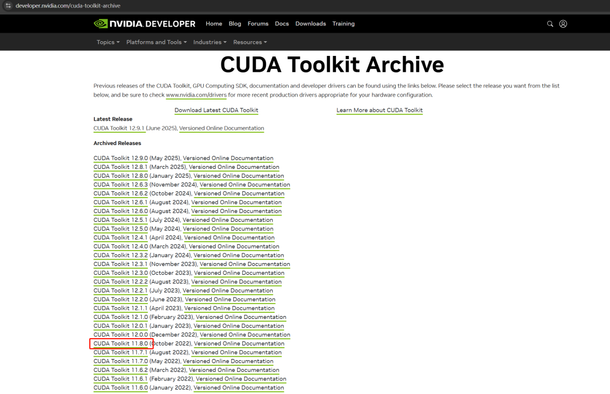
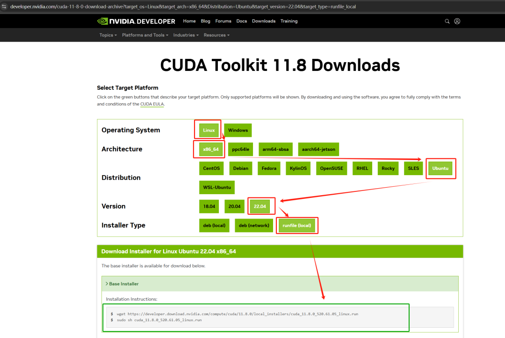
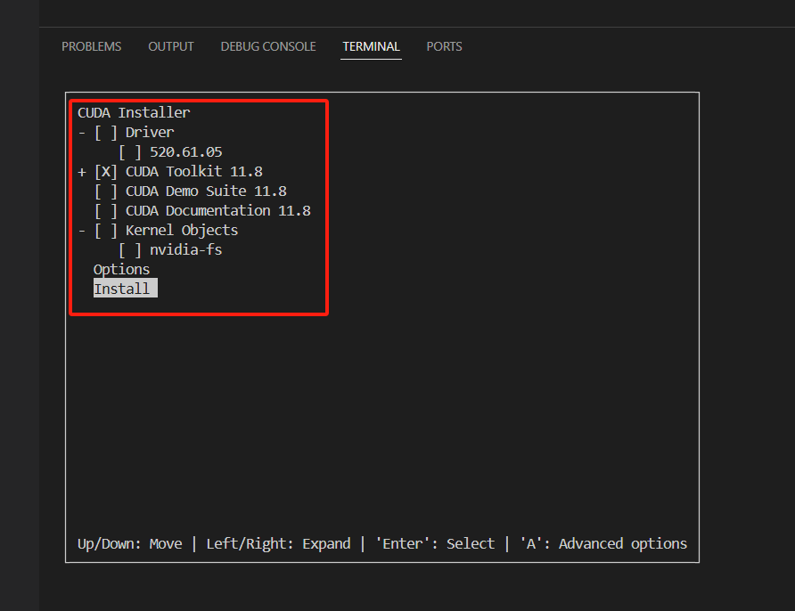
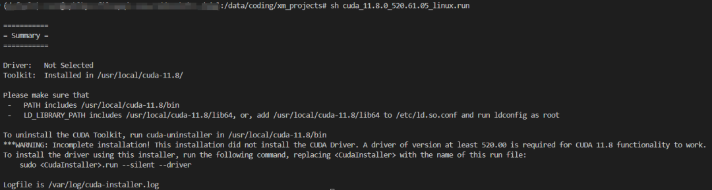
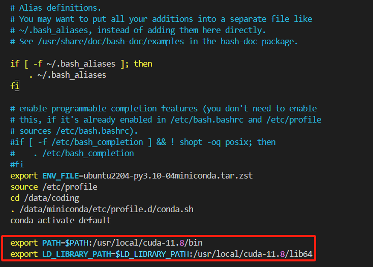
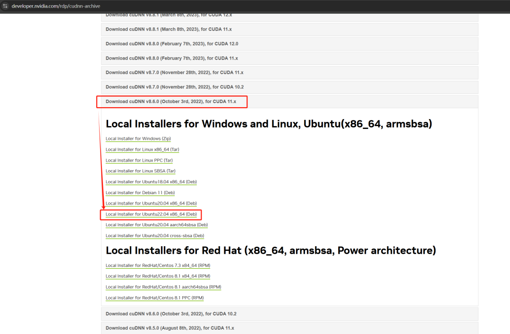
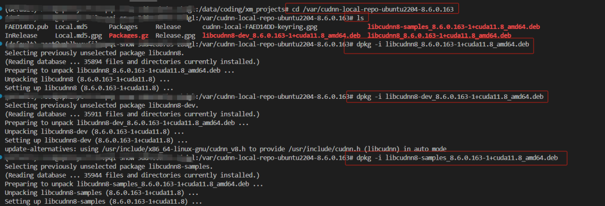

# Deep Learning Environment Setup and Operation (Part I) - Installing CUDA 11.8 and CUDNN 8.6.0 on Ubuntu 22.04 System (Beginner's Guide)

>

Avoid pitfalls guide! Ubuntu 22.04 - Comprehensive Installation of CUDA 11.8 + cuDNN 8.6.0! Beginner-friendly, zero failures, step by step guide to successfully configure a deep learning environment!

1) Check the operating system information

The following are the operational instructions:

```
(default) root@vphlhycvfilovpqi-snow-5dd4c6b7b5-zbdgl:/data/coding/xm_projects# cat /etc/os-release
PRETTY_NAME="Ubuntu 22.04.4 LTS"
NAME="Ubuntu"
VERSION_ID="22.04"
VERSION="22.04.4 LTS (Jammy Jellyfish)"
VERSION_CODENAME=jammy
ID=ubuntu
ID_LIKE=debian
HOME_URL="https://www.ubuntu.com/"
SUPPORT_URL="https://help.ubuntu.com/"
BUG_REPORT_URL="https://bugs.launchpad.net/ubuntu/"
PRIVACY_POLICY_URL="https://www.ubuntu.com/legal/terms-and-policies/privacy-policy"
UBUNTU_CODENAME=jammy
```

2) Check the conda version and python version.

The following are the operational instructions:

```
(default) root@vphlhycvfilovpqi-snow-5dd4c6b7b5-zbdgl:/data/coding/xm_projects# python --version
Python 3.10.15
(default) root@vphlhycvfilovpqi-snow-5dd4c6b7b5-zbdgl:/data/coding/xm_projects# which python
/data/miniconda/envs/default/bin/python
(default) root@vphlhycvfilovpqi-snow-5dd4c6b7b5-zbdgl:/data/coding/xm_projects# conda --version
conda 24.7.1
```

3) Check the GCC installation status

Installing CUDA requires the use of GCC, otherwise an error will occur. The operation instructions are as follows:

```
(default) root@vphlhycvfilovpqi-snow-5dd4c6b7b5-zbdgl:/data/coding/xm_projects# gcc --version
gcc (Ubuntu 11.4.0-1ubuntu1~22.04) 11.4.0
Copyright (C) 2021 Free Software Foundation, Inc.
This is free software; see the source for copying conditions.  There is NO
warranty; not even for MERCHANTABILITY or FITNESS FOR A PARTICULAR PURPOSE.
```

4) Check the GPU driver support for the highest version of CUDA.

The current highest version of CUDA supported by the graphics card driver is 12.4, and the operation instruction is as follows:

```
(default) root@vphlhycvfilovpqi-snow-5dd4c6b7b5-zbdgl:/data/coding/xm_projects# nvidia-smi
Thu Jul 19 09:21:14 2025
+-----------------------------------------------------------------------------------------+
| NVIDIA-SMI 550.54.15              Driver Version: 550.54.15      CUDA Version: 12.4     |
|-----------------------------------------+------------------------+----------------------+
| GPU  Name                 Persistence-M | Bus-Id          Disp.A | Volatile Uncorr. ECC |
| Fan  Temp   Perf          Pwr:Usage/Cap |           Memory-Usage | GPU-Util  Compute M. |
|                                         |                        |               MIG M. |
|=========================================+========================+======================|
|   0  Tesla P4                       Off |   00000000:04:00.0 Off |                  Off |
| N/A   24C    P8              6W /   75W |       0MiB /   8192MiB |      0%      Default |
|                                         |                        |                  N/A |
+-----------------------------------------+------------------------+----------------------+
+-----------------------------------------------------------------------------------------+
| Processes:                                                                              |
|  GPU   GI   CI        PID   Type   Process name                              GPU Memory |
|        ID   ID                                                               Usage      |
|=========================================================================================|
|  No running processes found                                                             |
+-----------------------------------------------------------------------------------------+
```

5) Use the free command to view system memory usage.

Ensure there is sufficient memory usage, operation instructions are as follows:

```
(default) root@vphlhycvfilovpqi-snow-5dd4c6b7b5-zbdgl:/data/coding/xm_projects# free -h
               total        used        free      shared  buff/cache   available
Mem:           125Gi        12Gi        48Gi       119Mi        64Gi       112Gi
Swap:             0B          0B          0B
```

6) Download CUDA

CUDA download link: https://developer.nvidia.com/cuda-toolkit-archive

#---# The interface is as follows:



#---# Click the CUDA Toolkit 11.8.0 window to navigate to the following interface (select the fixed version of system properties, here we use the system is Ubuntu22.04.4 LTS and select the following):



#---# As shown in the above image, use the below command to download it at the terminal:

```
(default) root@vphlhycvfilovpqi-snow-5dd4c6b7b5-zbdgl:/data/coding/xm_projects# wget https://developer.download.nvidia.com/compute/cuda/11.8.0/local_installers/cuda_11.8.0_520.61.05_linux.run
--2025-07-19 10:24:23--  https://developer.download.nvidia.com/compute/cuda/11.8.0/local_installers/cuda_11.8.0_520.61.05_linux.run
Resolving developer.download.nvidia.com (developer.download.nvidia.com)... 23.51.14.155, 23.51.14.152
Connecting to developer.download.nvidia.com (developer.download.nvidia.com)|23.51.14.155|:443... connected.
HTTP request sent, awaiting response... 301 Moved Permanently
Location: https://developer.download.nvidia.cn/compute/cuda/11.8.0/local_installers/cuda_11.8.0_520.61.05_linux.run [following]
--2025-07-19 10:24:23--  https://developer.download.nvidia.cn/compute/cuda/11.8.0/local_installers/cuda_11.8.0_520.61.05_linux.run
Resolving developer.download.nvidia.cn (developer.download.nvidia.cn)... 111.6.201.106, 111.6.201.109
Connecting to developer.download.nvidia.cn (developer.download.nvidia.cn)|111.6.201.106|:443... connected.
HTTP request sent, awaiting response... 200 OK
Length: 4336730777 (4.0G) [application/octet-stream]
Saving to: ‘cuda_11.8.0_520.61.05_linux.run’
cuda_11.8.0_520.61.05_linux.run                           100%[====================================================================================================================================>]   4.04G  34.5MB/s    in 1m 59s
2025-07-19 10:26:23 (34.7 MB/s) - ‘cuda_11.8.0_520.61.05_linux.run’ saved [4336730777/4336730777]
```

7) Install CUDA

#---# After downloading, use the following command to install:

```
sh cuda_11.8.0_520.61.05_linux.run
```

#---# Press the < Up/Down Arrow Keys > to select "continue", press the < Enter Key > on the keyboard.
#---# Pop up a window and input "accept". Press the < Enter key> on the keyboard.
#---# Pop-up window uses < ↑ and < ↓ keys> and < Space key> to select and deselect
#---# Finally, select "install" and click the < Enter key> to proceed with the installation, as shown in the following figure:



#---# After installation, a pop-up window will appear as shown below:



#---# Set CUDA environment variables
Add the following two lines of code at the end of the opened document:

```
export PATH=$PATH:/usr/local/cuda-11.8/bin
export LD_LIBRARY_PATH=$LD_LIBRARY_PATH:/usr/local/cuda-11.8/lib64
```

```
(default) root@vphlhycvfilovpqi-snow-5dd4c6b7b5-zbdgl:/data/coding/xm_projects# vim ~/.bashrc
```

See the image:



```
(default) root@vphlhycvfilovpqi-snow-5dd4c6b7b5-zbdgl:/data/coding/xm_projects# source ~/.bashrc
```

#---# Verify if CUDA is installed successfully (print the following to indicate successful installation)

```
(default) root@vphlhycvfilovpqi-snow-5dd4c6b7b5-zbdgl:/data/coding# nvcc -V
nvcc: NVIDIA (R) Cuda compiler driver
Copyright (c) 2005-2022 NVIDIA Corporation
Built on Wed_Sep_21_10:33:58_PDT_2022
Cuda compilation tools, release 11.8, V11.8.89
Build cuda_11.8.r11.8/compiler.31833905_0
```

#### 8) Installing cuDNN 8.6.0

cuDNN download link: https://developer.nvidia.com/rdp/cudnn-archive
#---# Open the website, find the corresponding cuDNN according to your CUDA version and Ubuntu system version, as shown in the following figure:



#---# Click to download the deb file, and copy the link can be executed in the command line as follows:

```
(default) root@vphlhycvfilovpqi-snow-5dd4c6b7b5-zbdgl:/data/coding/xm_projects# wget -c "https://developer.download.nvidia.cn/compute/cudnn/secure/8.6.0/local_installers/11.8/cudnn-local-repo-ubuntu2204-8.6.0.163_1.0-1_amd64.deb?__token__=exp=1752721445~hmac=3b1c098ee97ce0ed43bdb45f27876405bf56a6d6bb80e94a1b20e28d0e82e550&t=eyJscyI6IndlYnNpdGUiLCJsc2QiOiJsaW5rLnpoaWh1LmNvbS8/dGFyZ2V0PWh0dHBzJTNBLy9kZXZlbG9wZXIubnZpZGlhLmNvbS9jdWRhLWdwdXMifQ=="
The destination name is too long (273), reducing to 236
--2025-07-17 10:54:19--  https://developer.download.nvidia.cn/compute/cudnn/secure/8.6.0/local_installers/11.8/cudnn-local-repo-ubuntu2204-8.6.0.163_1.0-1_amd64.deb?__token__=exp=1752721445~hmac=3b1c098ee97ce0ed43bdb45f27876405bf56a6d6bb80e94a1b20e28d0e82e550&t=eyJscyI6IndlYnNpdGUiLCJsc2QiOiJsaW5rLnpoaWh1LmNvbS8/dGFyZ2V0PWh0dHBzJTNBLy9kZXZlbG9wZXIubnZpZGlhLmNvbS9jdWRhLWdwdXMifQ==
Resolving developer.download.nvidia.cn (developer.download.nvidia.cn)... 111.6.201.109, 111.6.201.106
Connecting to developer.download.nvidia.cn (developer.download.nvidia.cn)|111.6.201.109|:443... connected.
HTTP request sent, awaiting response... 200 OK
Length: 884837062 (844M) [application/x-deb]
Saving to: ‘cudnn-local-repo-ubuntu2204-8.6.0.163_1.0-1_amd64.deb?__token__=exp=1752721445~hmac=3b1c098ee97ce0ed43bdb45f27876405bf56a6d6bb80e94a1b20e28d0e82e550&t=eyJscyI6IndlYnNpdGUiLCJsc2QiOiJsaW5rLnpoaWh1LmNvbS8%2FdGFyZ2V0PWh0dHBzJTNBLy9kZXZlbG9’
cudnn-local-repo-ubuntu2204-8.6.0.163_1.0-1_amd64.deb?__to 100%[========================================================================================================================================>] 843.85M  34.5MB/s    in 24s
2025-07-17 10:54:43 (35.8 MB/s) - ‘cudnn-local-repo-ubuntu2204-8.6.0.163_1.0-1_amd64.deb?__token__=exp=1752721445~hmac=3b1c098ee97ce0ed43bdb45f27876405bf56a6d6bb80e94a1b20e28d0e82e550&t=eyJscyI6IndlYnNpdGUiLCJsc2QiOiJsaW5rLnpoaWh1LmNvbS8%2FdGFyZ2V0PWh0dHBzJTNBLy9kZXZlbG9’ saved [884837062/884837062]
```

#---# File Rename

```
(default) root@vphlhycvfilovpqi-snow-5dd4c6b7b5-zbdgl:/data/coding/xm_projects# mv cudnn-local-repo-ubuntu2204-8.6.0.163_1.0-1_amd64.deb\?__token__\=exp\=1752721445~hmac\=3b1c098ee97ce0ed43bdb45f27876405bf56a6d6bb80e94a1b20e28d0e82e550\&t\=eyJscyI6IndlYnNpdGUiLCJsc2QiOiJsaW5rLnpoaWh1LmNvbS8%2FdGFyZ2V0PWh0dHBzJTNBLy9kZXZlbG9 cudnn-local-repo-ubuntu2204-8.6.0.163_1.0-1_amd64.deb
```

#---# Run the *.deb file using the below command:

```
(default) root@vphlhycvfilovpqi-snow-5dd4c6b7b5-zbdgl:/data/coding/xm_projects# dpkg -i cudnn-local-repo-ubuntu2204-8.6.0.163_1.0-1_amd64.deb
Selecting previously unselected package cudnn-local-repo-ubuntu2204-8.6.0.163.
(Reading database ... 35878 files and directories currently installed.)
Preparing to unpack cudnn-local-repo-ubuntu2204-8.6.0.163_1.0-1_amd64.deb ...
Unpacking cudnn-local-repo-ubuntu2204-8.6.0.163 (1.0-1) ...
Setting up cudnn-local-repo-ubuntu2204-8.6.0.163 (1.0-1) ...
The public cudnn-local-repo-ubuntu2204-8.6.0.163 GPG key does not appear to be installed.
To install the key, run this command:
sudo cp /var/cudnn-local-repo-ubuntu2204-8.6.0.163/cudnn-local-FAED14DD-keyring.gpg /usr/share/keyrings/
```

#---# Copy the key according to the prompt
The instruction printed at the top terminal requests the use of the instructions below to copy the key. You can copy according to the information about the instructions you have installed and printed:

```
(default) root@vphlhycvfilovpqi-snow-5dd4c6b7b5-zbdgl:/data/coding/xm_projects# cp /var/cudnn-local-repo-ubuntu2204-8.6.0.163/cudnn-local-FAED14DD-keyring.gpg /usr/share/keyrings/
```

#---# Important! Important! Important! (Installing files such as libcudnn8, libcudnn8-dev, libcudnn8-samples)
See the image:



#---# Check the installation result of cuDNN (Method 1)

```
(default) root@vphlhycvfilovpqi-snow-5dd4c6b7b5-zbdgl:/var/cudnn-local-repo-ubuntu2204-8.6.0.163# cat /usr/include/x86_64-linux-gnu/cudnn_version_v8.h | grep CUDNN_MAJOR -A 2
#define CUDNN_MAJOR 8
#define CUDNN_MINOR 6
#define CUDNN_PATCHLEVEL 0
--
#define CUDNN_VERSION (CUDNN_MAJOR * 1000 + CUDNN_MINOR * 100 + CUDNN_PATCHLEVEL)
/* cannot use constexpr here since this is a C-only file */
```

@@@@@@@@ View the cudnn version in another way @@@@@@@@
#---# Check the installation result of cuDNN (method two)

```
(default) root@vphlhycvfilovpqi-snow-5dd4c6b7b5-zbdgl:/data/coding# dpkg -l | grep cudnn
ii  cudnn-local-repo-ubuntu2204-8.6.0.163 1.0-1                                   amd64        cudnn-local repository configuration files
ii  libcudnn8                             8.6.0.163-1+cuda11.8                    amd64        cuDNN runtime libraries
ii  libcudnn8-dev                         8.6.0.163-1+cuda11.8                    amd64        cuDNN development libraries and headers
ii  libcudnn8-samples                     8.6.0.163-1+cuda11.8                    amd64        cuDNN samples
```

<<Printed version number, indicating successful installation, cuda11.8 and cudnn8.6.0 have been installed here>>>


## Payment

Here is a pay link on Stripe ( https://buy.stripe.com/3cs8yP7sY87d0vu9AB ). Please contact me lonlonago@foxmail.com after funding $89, and I will send you a complete data files , thank you!


